# 《系统设计与分析》第三次作业报告

## 基于事件监听机制的 RBAC 校园工单权限管理系统

### 摘要

本项目使用 Java 17、Swing、SQLite 和 JDBC 实现一个单机校园工单管理系统。作业重点不是工单业务本身，而是通过真实可运行程序说明四件事：用户如何通过角色获得权限；角色与权限如何在数据库中持久化；菜单、页面、按钮和业务服务如何分别实施权限控制；Swing 事件监听器如何把用户操作传递到业务层并安全更新界面。

系统实现 RBAC0。用户可拥有多个角色，角色可拥有多个权限，用户的有效权限是各角色权限的并集。管理员可在运行时调整角色授权；授权提交后，已有会话的下一次业务调用会从数据库重新读取权限，因此新增权限立即可用，撤销权限立即阻止操作。界面中的隐藏菜单和禁用按钮用于提供清晰反馈，Service 层的实时校验构成最终安全边界。

## 1. 作业目标与要求

本次作业围绕“基于监听器的 RBAC 权限管理”展开，具体目标如下：

1. 建立用户、角色、权限及其多对多关系，实现 RBAC0。
2. 使用 SQLite 保存用户角色关系和角色权限关系，程序重启后保留授权变更。
3. 使用 `ActionListener` 响应登录、导航、查询、新增、编辑、删除、授权等操作。
4. 在同一套界面中展示不同角色的菜单、页面和按钮差异。
5. 管理员能够动态授予和撤销权限，并验证授权对真实业务操作的影响。
6. 即使绕过界面直接调用 Service，未授权操作仍必须被拒绝并记录审计。

项目保持课程作业范围：采用单机 Swing 应用和 RBAC0，不增加 Web 服务、复杂组织模型、角色继承或额外业务模块。

## 2. RBAC0 原理与本项目模型

RBAC（Role-Based Access Control，基于角色的访问控制）不直接为每个用户逐项配置操作，而是在用户与权限之间加入角色。设用户集合为 `U`、角色集合为 `R`、权限集合为 `P`，则本项目保存两类多对多关系：

- 用户角色分配 `UA ⊆ U × R`；
- 角色权限分配 `PA ⊆ R × P`。

用户 `u` 的有效权限为：

```text
permissions(u) = ⋃ permissions(role)，其中 role ∈ roles(u)
```

系统遵循“默认拒绝”：只有查询得到所需权限时才执行操作。角色代码 `ADMIN`、`MANAGER`、`STAFF`、`VIEWER` 只是初始化数据，程序不会通过用户名或角色名称特殊放行。管理员可以修改这些角色的权限，也可以为用户分配多个角色。

### 2.1 用户、角色和权限关系

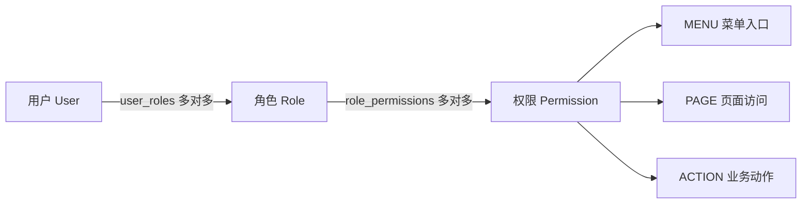

初始角色用于课堂演示，实际授权仍来自数据库：

| 角色 | 初始能力 | 工单页典型效果 |
|---|---|---|
| ADMIN | 全部菜单、页面、业务和管理能力 | 所有按钮可用，可配置角色权限 |
| MANAGER | 工单维护、分派、导出和统计 | 可新增、编辑、分派、改状态、导出，不可删除 |
| STAFF | 查看、新增、编辑和改状态 | 删除、分派、导出按钮禁用 |
| VIEWER | 查看工单 | 只有查询可用 |

这张表描述初始化状态，不是写在 UI 中的角色判断。界面根据当前会话权限集合决定显示，Service 根据数据库中的当前授权决定是否执行。

## 3. 系统架构与数据库设计

### 3.1 分层架构

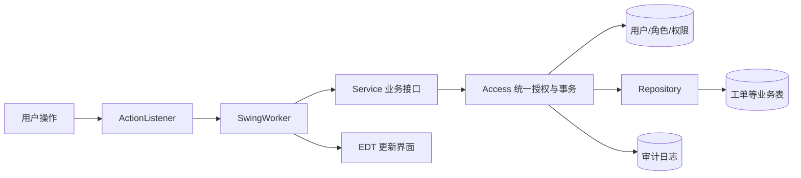

- `ui`：登录、工作台、工单、用户、角色权限、统计和审计页面。
- `event`：封装监听器与 `SwingWorker` 的后台执行和 EDT 回调。
- `service`：声明业务边界和每个操作所需权限。
- `infrastructure`：SQLite 事务、可信会话、实时授权、密码摘要和审计。
- `repository`：执行参数化 SQL 并映射领域对象。
- `model`：用户、角色、权限、会话、工单、统计和审计记录。

UI 只调用 Service 接口，不直接访问数据库。这样既能让监听器代码保持清楚，也能防止界面遗漏检查时绕过授权。

### 3.2 数据库 ER 图

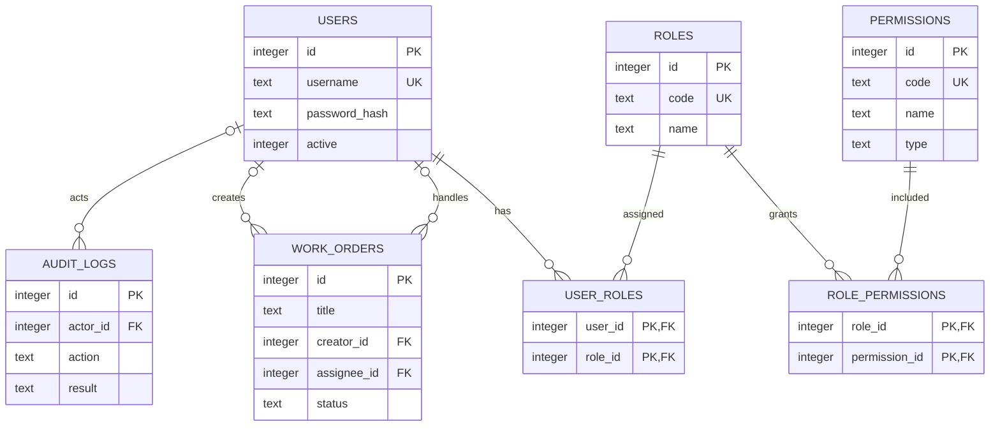

七张业务表之外，`schema_version` 记录数据库版本。初始化只在版本 1 不存在时执行，因此重启不会重新插入初始授权，也不会把已撤销权限补回。`user_roles` 与 `role_permissions` 使用联合主键避免重复关系；外键、唯一约束、状态检查和索引维护数据一致性。

密码不以明文保存，而是使用 PBKDF2-HMAC-SHA256、每用户随机盐和 600,000 次迭代。登录成功后，进程内 `SessionRegistry` 签发随机不透明令牌；Service 只从令牌解析操作人，不接受业务参数伪造调用者身份。

## 4. 监听器与事件响应机制

Swing 的事件派发线程（EDT）负责处理按钮点击和绘制界面。数据库查询与密码计算可能耗时，若直接放在 EDT 中会导致窗口卡顿。本项目采用以下事件链：

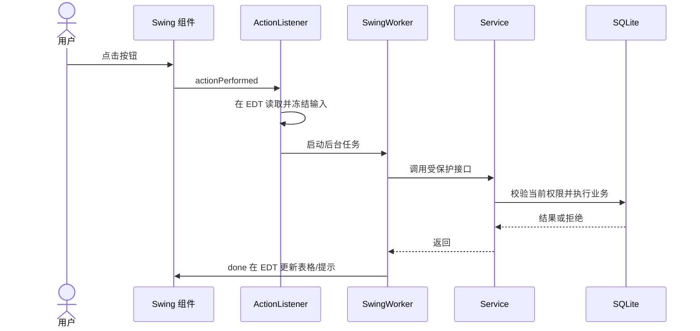

`BackgroundAction` 是通用监听器适配器，关键逻辑如下：

```java
@Override public void actionPerformed(ActionEvent event) {
    if (running) return;
    running = true;
    new SwingWorker<T, Void>() {
        @Override protected T doInBackground() throws Exception {
            return work.call();
        }
        @Override protected void done() {
            running = false;
            if (!current.getAsBoolean()) return;
            try { success.accept(get()); }
            catch (ExecutionException ex) { failure.accept(ex.getCause()); }
        }
    }.execute();
}
```

`running` 防止同一监听器被连续触发；`current` 检查会话令牌和页面修订号。用户退出登录、切换账号或离开页面后，旧后台任务即使完成，也不会再修改新界面。

登录按钮也显式绑定 `ActionListener`：监听器在 EDT 读取用户名和密码，把认证交给 `BackgroundAction`，完成后再进入主界面。工单查询、删除、角色授权和刷新权限使用同样流程，形成统一的“用户事件 → Service → 授权 → DAO/数据库 → UI 更新”路径。

## 5. 关键权限判断代码与解释

### 5.1 每次服务调用读取当前权限

统一授权入口从会话令牌取得用户 ID，检查账号仍然有效，然后查询多角色权限并集：

```java
Long id = sessions.resolve(token);
if (id == null) throw new Denied("登录会话无效，请重新登录");

Set<String> current = effectivePermissions(connection, id);
if (!current.containsAll(required)) {
    Set<String> missing = new TreeSet<>(required);
    missing.removeAll(current);
    throw new Denied("权限不足：" + String.join("、", missing));
}
```

权限查询使用 `user_roles → role_permissions → permissions` 联表和 `DISTINCT`。由于查询发生在每次 Service 调用中，授权变更不依赖重新登录。写操作使用同一 SQLite 写事务完成授权检查、业务修改和成功审计；发生错误则整体回滚。权限拒绝在回滚后用独立事务写入审计，避免拒绝记录一起消失。

### 5.2 工单删除的服务层保护

```java
@Override public void delete(String token, long id) {
    access.write(token, "workorder:delete", Long.toString(id),
            Set.of("workorder:delete"), (connection, actor) -> {
        try (PreparedStatement statement = connection.prepareStatement(
                "DELETE FROM work_orders WHERE id=?")) {
            statement.setLong(1, id);
            changed(statement.executeUpdate());
        }
        return null;
    });
}
```

删除方法不接收用户名、角色名或“是否管理员”布尔值，只接收可信令牌和工单 ID。即使调用者绕过禁用按钮直接调用该方法，只要数据库中缺少 `workorder:delete`，`Access` 就会在执行 `DELETE` 前拒绝。

## 6. 不同角色的页面效果

### 6.1 工作台

工作台显示当前账号、角色、可访问模块和中文能力摘要。英文权限编码仅在角色配置等需要精确核对的场景作为辅助信息，不再在首页逐行堆叠。

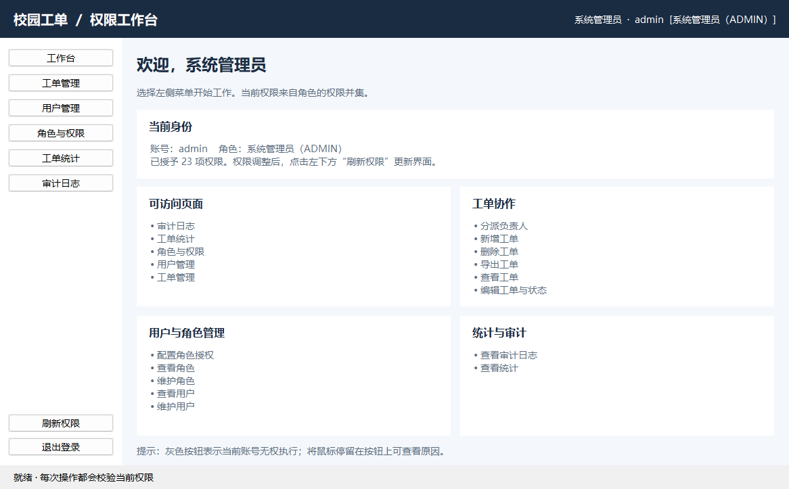

### 6.2 工单管理

工单页将筛选区、操作区、表格和选中工单详情区紧凑排列，并明确显示“当前可操作”能力。按钮是否启用仍由当前权限集合决定。

管理员工单页：

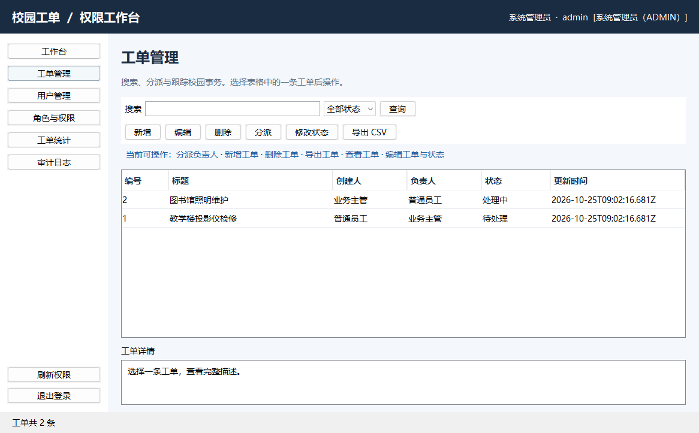

只读用户进入同一页面时，仅查询可用，其余动作禁用并给出原因：

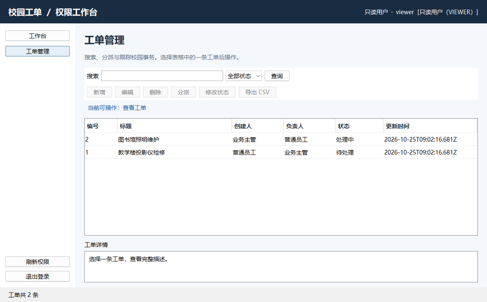

### 6.3 角色与权限管理

角色页采用“角色列表 + 所选角色权限详情”的关系视图。选择角色后，程序通过 `Roles.permissions` 和 `Roles.permissionIds` 读取数据库关系，并按 MENU、PAGE、ACTION 展示。配置弹窗沿用相同数据源，通过分组复选框修改 `role_permissions`，不会在 UI 中复制角色授权表。

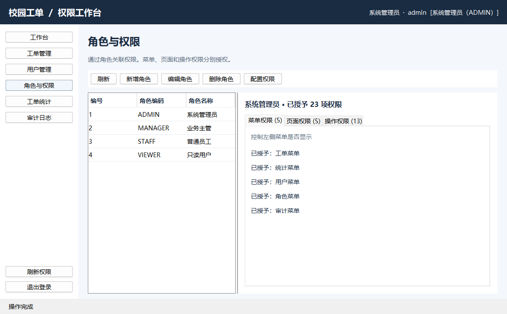

权限配置弹窗保留数据库中的权限编码作为核对信息，同时按菜单、页面和操作分组显示中文名称：

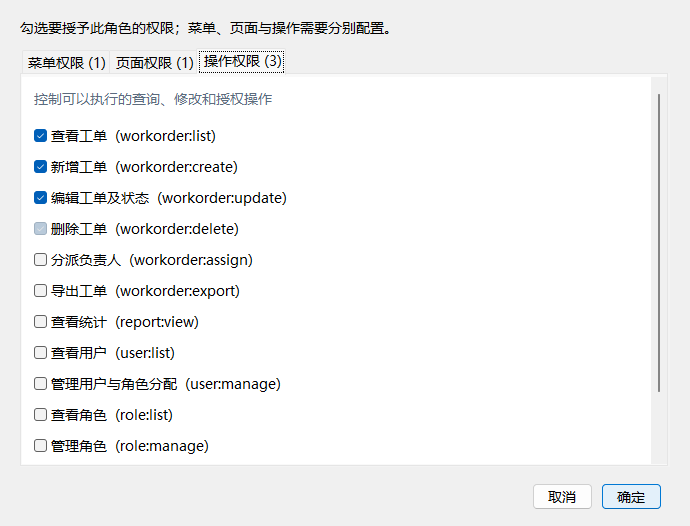

## 7. 动态授权实验

实验使用临时真实 SQLite 文件、正式 Service 和真实 Swing 组件，不用固定布尔值模拟权限。操作与预期如下：

| 步骤 | 操作 | 观察结果 |
|---:|---|---|
| 1 | STAFF 与 VIEWER 分别进入工单页 | STAFF 可新增、编辑和改状态；VIEWER 只有查询可用 |
| 2 | ADMIN 选择 STAFF，在权限弹窗勾选“删除工单（`workorder:delete`）” | `role_permissions` 增加对应关系 |
| 3 | STAFF 刷新权限并删除测试工单 | 删除按钮变为可用，确认后数据库记录实际删除 |
| 4 | ADMIN 取消 STAFF 的删除权限 | 授权关系从数据库删除 |
| 5 | STAFF 再次尝试删除 | 刷新后按钮禁用；旧会话直接调用 Service 也立即被拒绝 |
| 6 | 重新打开同一数据库 | 撤权状态保持，初始化过程没有恢复删除权限 |

自动化验收同时检查“授予后成功删除”“撤销后无法删除”“拒绝后工单仍存在”和“重启后授权状态保持”。GUI 验收检查权限配置弹窗以及删除确认弹窗的取消、确认路径，从而覆盖原先主要由服务测试验证的模态交互。

授予删除权限后，STAFF 的“删除”按钮和当前可操作说明同步变化：

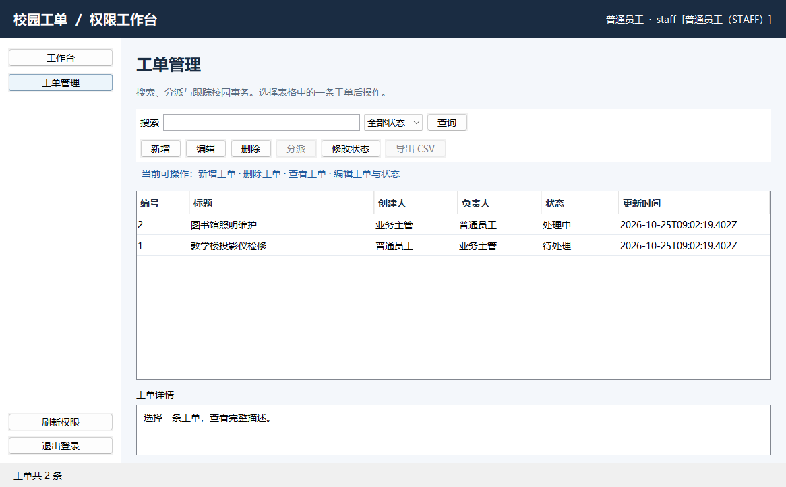

管理员撤销权限、STAFF 刷新权限后，同一按钮重新禁用：


实际删除前还会显示模态确认框；GUI 测试分别验证“取消后保留工单”和“确认后实际删除”：

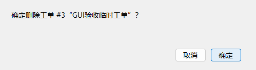

## 8. 菜单、页面、按钮和业务层控制的差异

| 层级 | 示例 | 作用 | 课程意义 |
|---|---|---|---|
| 菜单 | `menu:roles` | 决定侧栏是否显示“角色与权限”入口 | 展示不同角色的导航差异 |
| 页面 | `page:roles:view` | 点击入口时再次校验能否进入页面 | 防止只靠隐藏入口控制访问 |
| 按钮 | `workorder:delete` | 决定“删除”按钮是否启用并提示缺少权限 | 在同一页面直观比较角色能力 |
| Service | `workorder:delete` | 调用时查询数据库当前权限，决定是否执行 SQL | 构成不能由 UI 绕过的安全边界 |

菜单、页面和按钮控制提高界面的可理解性，但它们都可能因旧界面、代码错误或直接调用而被绕过。因此 Service 层校验不可省略。权限撤销后，旧窗口可能尚未刷新按钮状态，但下一次服务调用仍会根据数据库当前值拒绝，这也说明“界面呈现”和“安全授权”是两个层次。

## 9. RBAC0—RBAC3 比较

| 模型 | 核心能力 | 典型场景 | 本项目状态 |
|---|---|---|---|
| RBAC0 | 用户、角色、权限、多对多分配和会话 | 基础权限管理 | 已实现 |
| RBAC1 | 角色层次与权限继承 | 经理继承员工权限 | 仅分析 |
| RBAC2 | 角色约束，如互斥、基数、先决角色 | 申请人与审批人职责分离 | 仅分析 |
| RBAC3 | RBAC1 与 RBAC2 的组合 | 大型组织的层级与约束治理 | 仅分析 |

若实现 RBAC1，需要增加角色继承表、递归权限查询和循环检测；若实现 RBAC2，需要增加互斥角色、最大用户数或先决角色规则，并在分配事务中验证。两者都会显著增加作业复杂度。本项目选择完整、可验证的 RBAC0，避免让扩展模型掩盖课程要求中的核心关系。

RBAC 权限与业务数据范围也应区分。“允许编辑工单”属于 RBAC；“只能编辑本人创建的工单”属于业务规则或属性控制。本作业不增加后一类规则。

## 10. 测试与结果

测试全部使用真实 SQLite 文件。默认测试覆盖数据库初始化与幂等性、密码摘要、登录和会话、四类角色、动态授权与撤权、多角色权限并集、服务层越权拒绝、最后管理员保护、审计、工单生命周期、CSV 导出及后台线程行为。

| 验证层次 | 命令 | 覆盖内容 |
|---|---|---|
| 完整构建与非 GUI 测试 | `.\mvnw.cmd clean verify` | 数据库、RBAC、业务、审计、事件线程和可执行 JAR |
| 原生 Swing GUI 测试 | `.\mvnw.cmd -Pgui-tests test` | 真窗口、真实服务、角色页面差异、模态弹窗和截图 |
| 可执行 JAR 冒烟 | `java -jar target\campus-work-order-rbac.jar --db target\jar-smoke\campus.db --init-only` | 打包依赖、SQLite 驱动和首次初始化 |

2026 年 10 月 25 日最终复验结果为：`clean verify` 的 35 项非 GUI 测试全部通过，GUI profile 的 3 项测试全部通过，可执行 JAR 初始化真实 SQLite 成功。详细环境、用例映射和命令记录在 `TEST_REPORT.md`；GUI 截图由 `GuiDatabaseTest` 在真实窗口中生成。

## 11. 总结

本项目以规模适中的校园工单场景完整实现了 RBAC0。角色权限关系保存在 SQLite 中，管理员能够动态修改；菜单、页面和按钮清楚展示权限差异，Service 则对每次操作重新查询数据库并拒绝越权。Swing `ActionListener` 与 `SwingWorker` 把用户事件、后台业务和 EDT 更新连接成可解释的事件处理流程。

系统边界也很明确：会话位于单机进程内，程序重启后需要重新登录；未实现角色继承、职责分离、组织结构和行级数据范围；拥有本机数据库文件写权限的人仍可绕过应用直接编辑 SQLite。这些限制不影响本次课程作业对 RBAC、监听器、权限持久化和分层授权机制的验证。
