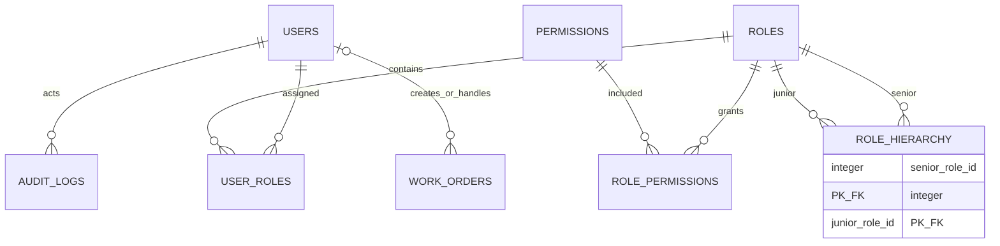
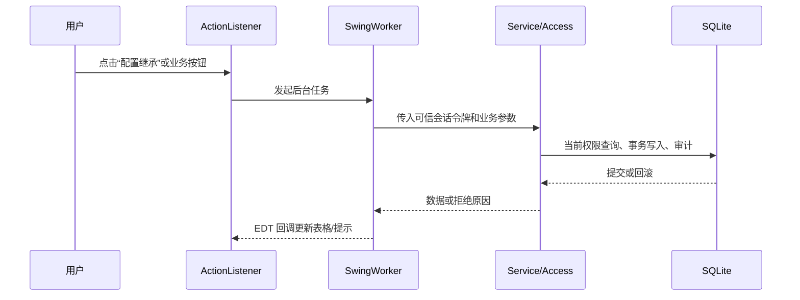
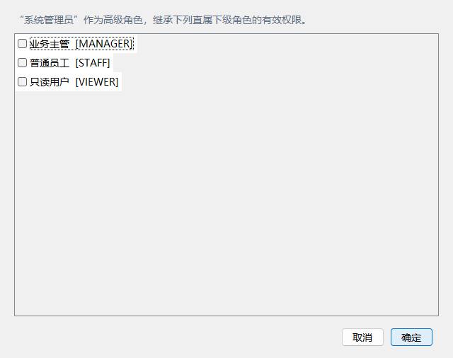

# 《系统设计与分析》第三次作业报告

## 基于事件监听机制的校园工单 RBAC 权限管理系统

## 1. 作业目标与完成范围

本作业以 Java 17、Swing、SQLite JDBC 和 Maven 实现单机校园工单系统，重点是用可运行程序说明权限管理机制：用户通过角色取得权限，角色—权限关系持久化到 SQLite；界面事件由监听器驱动；菜单、页面、按钮和业务服务分别进行权限控制。本次在原有 RBAC0 基础上实现 **RBAC1 角色层次**，没有增加网络服务、Web 前端或无关业务模块。

系统含登录、工作台、工单、用户、角色与权限、统计、审计页面。初始角色为 ADMIN、MANAGER、STAFF、VIEWER，初始关系只用于创建演示数据，程序不按用户名或角色名特判放行。

## 2. RBAC0 与 RBAC1 原理

RBAC0 的对象集合为用户 `U`、角色 `R`、权限 `P`：用户角色关系 `UA ⊆ U × R`，角色权限关系 `PA ⊆ R × P`。用户有效权限是其全部直接角色权限的并集。

```text
permissions0(u) = ⋃ permissions(r), r ∈ roles(u)
```

RBAC1 在此基础上增加角色层次 `RH ⊆ R × R`。`(senior, junior)` 的语义是“高级角色继承低级角色的有效权限”。本项目把关系保存为 `role_hierarchy(senior_role_id, junior_role_id)`，使用递归 CTE 找到每个直接角色的全部下级角色，再合并权限：

```text
reachable(u) = directRoles(u) ∪ allJuniorRoles(directRoles(u))
permissions1(u) = ⋃ permissions(r), r ∈ reachable(u)
```

层次只扩大相应高级角色的有效权限；删除层次只移除继承来源，直接授权不受影响。数据库禁止同一角色继承自己；服务层在写入前检测“下级是否已可达高级角色”，从而拒绝环。

## 3. 用户、角色、权限和数据库设计



`role_hierarchy` 以两列组成主键，并有外键 `ON DELETE CASCADE`。删除角色时，其作为高级或低级角色的关系会自动清理。`migration_v2.sql` 是正式的版本 2 迁移：新库依次建立基础表、种子数据和迁移；旧版本 1 数据库只执行迁移。迁移不会重建用户、密码、工单或 `role_permissions`，也不预置层次关系，因此不会意外扩大既有权限。

| 初始角色 | 初始用途 | 工单界面主要能力 |
|---|---|---|
| ADMIN | 系统管理和授权 | 全部菜单、页面、业务操作 |
| MANAGER | 业务协调 | 新增、编辑、分派、导出、统计；不能删除，也不能给 ADMIN 分派 |
| STAFF | 普通处理 | 查看、新增、编辑、改状态 |
| VIEWER | 只读查看 | 查询工单 |

角色层次默认为空，所以上述初始效果保持 RBAC0 行为。管理员可在“配置继承”中将例如“MANAGER 继承 STAFF”保存为一条数据库关系。

## 4. 系统架构与监听器事件机制



界面中的 `ActionListener` 只负责收集输入和触发 `BackgroundAction`；数据库和密码计算在 `SwingWorker` 后台执行，结果回到 EDT 更新。退出登录后，旧会话对应的异步回调会被丢弃。示例代码位于 [CampusApplication.java](../src/main/java/edu/campus/rbac/ui/CampusApplication.java) 和 [BackgroundAction.java](../src/main/java/edu/campus/rbac/event/BackgroundAction.java)。

## 5. 关键权限判断

服务层入口在 [Access.java](../src/main/java/edu/campus/rbac/infrastructure/Access.java)。每次读取或写入都从随机不透明会话令牌解析操作人，检查用户是否有效，再从数据库计算当前有效权限；写操作在同一个 SQLite 写事务内完成授权检查、业务写入和成功审计。拒绝请求在回滚后单独审计。

```java
WITH RECURSIVE reachable(role_id) AS (
    SELECT role_id FROM user_roles WHERE user_id=?
    UNION
    SELECT h.junior_role_id
    FROM role_hierarchy h JOIN reachable r ON h.senior_role_id=r.role_id
)
SELECT DISTINCT p.code
FROM permissions p JOIN role_permissions rp ON rp.permission_id=p.id
JOIN reachable r ON r.role_id=rp.role_id
```

这段查询是有效权限的唯一来源。界面的权限快照只用于显示和控制按钮状态，不能作为安全边界。角色继承的新增、删除和批量配置复用 `role:manage` 与 `permission:grant`；服务层检查角色存在性、自继承、重复关系和环，并在同一事务内执行“至少保留一个具备完整管理能力的启用用户”保护。

## 6. 页面、菜单、按钮与业务层的差异

| 层次 | 例子 | 目的 | 是否最终安全边界 |
|---|---|---|---|
| 菜单 | `menu:roles` | 决定是否显示导航入口 | 否 |
| 页面 | `page:roles:view` | 决定是否允许进入模块 | 否 |
| 按钮 | `workorder:delete` | 禁用无权限操作并给出提示 | 否 |
| 服务 | `Access.write(... required ...)` | 再次按数据库当前状态拒绝越权请求 | 是 |

因此，旧会话即使仍显示一个过期按钮，在管理员撤权后的下一次 Service 调用仍会被拒绝；刷新权限后，界面也会立即同步为禁用状态。

## 7. 不同角色与 RBAC1 页面效果

工单页面用同一张表格展示角色差异：VIEWER 的新增、编辑、删除、分派、状态、导出按钮均不可用；STAFF 仅能处理基础工单；MANAGER 可分派普通用户但不能向 ADMIN 分派；ADMIN 能管理授权。


角色页把有效权限按 MENU、PAGE、ACTION 三类显示，并在每项前标明“直接”“继承”或“直接 + 继承”；上方显示直属下级角色。它不把授权关系写死在 UI，所有数据均来自 `Services.Roles` 查询。


继承配置弹窗明确方向：当前角色是高级角色，勾选的角色是其直属下级。权限编码保留在括号中，方便课程展示和源码对应。



## 8. 动态授权实验及结果

实验采用真实 SQLite 和真实 Service：创建父角色与子角色，在子角色授予 `workorder:delete`，再把 STAFF 用户分配到父角色。

1. 未建立父→子关系时，STAFF 的既有会话没有删除权限。
2. 管理员建立继承关系后，不重新登录即可通过 `permissions.refresh` 和下一次业务调用取得删除能力。
3. 移除关系后，STAFF 的同一会话立即失去该能力。
4. 若父角色又有直接 `workorder:delete`，移除关系后能力仍保留。
5. 重启程序后，迁移与初始化不会恢复被撤销的直接授权或修改过的工单数据。

上述结果由 [RoleHierarchyTest.java](../src/test/java/edu/campus/rbac/RoleHierarchyTest.java) 的真实数据库测试覆盖；它还验证了多层继承、权限去重和来源、环拒绝、角色删除级联清理、非管理员拒绝、最后有效管理员保护、版本 1 升级和版本 2 幂等启动。

## 9. RBAC0—RBAC3 简要比较

| 模型 | 增加能力 | 本项目状态 |
|---|---|---|
| RBAC0 | 用户—角色—权限多对多关系 | 已实现 |
| RBAC1 | 角色层次和权限继承 | 已实现 |
| RBAC2 | 静态/动态职责分离、基数等约束 | 未实现；课程分析见 `RBAC_ANALYSIS.md` |
| RBAC3 | RBAC1 与 RBAC2 的组合 | 未实现；超出本次作业范围 |

本项目仅实现课程所需的 RBAC1，不把层次关系误当作职责分离或组织架构功能。

## 10. 测试与总结

测试使用 JUnit 5、真实 SQLite、JDBC 和真实 Service。非图形测试覆盖初始化、迁移、认证、会话、管理员保护、工单越权、审计、RBAC0 回归与 RBAC1；图形测试在支持桌面的环境中打开真实 Swing 窗口，验证角色页面、权限配置和继承配置模态框，并生成本报告引用的截图。

本系统以小型桌面程序完整呈现了“监听器事件 → 后台任务 → 统一授权 → SQLite 事务 → EDT 更新”的课程链路。RBAC1 的角色层次关系可配置、可持久化、可追溯来源，并与原有动态撤权、审计、最后管理员保护共同工作。