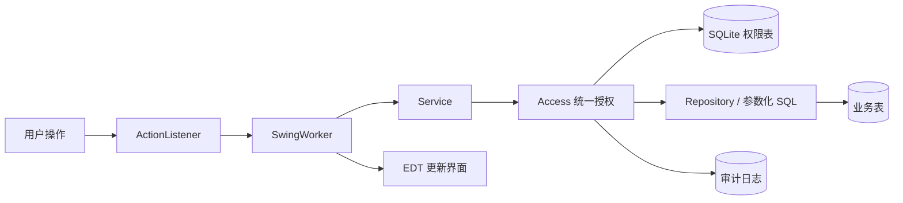
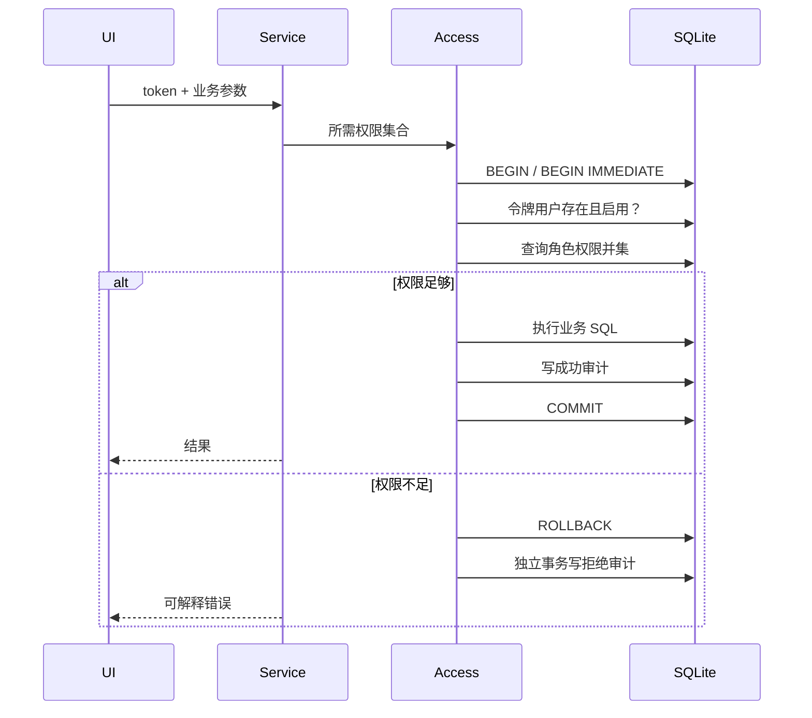

# 系统设计

## 1. 分层架构

系统是单进程桌面应用，但按职责划分为六层。UI 只持有 Service 接口；DAO 不负责授权；统一授权入口同时控制真实身份、数据库权限与事务。



- `ui`：页面、表格、对话框以及菜单和按钮的权限呈现。
- `event`：把监听器中的耗时 Service 调用放入后台线程，并在 EDT 回调。
- `service`：业务边界。每个公开操作声明所需权限。
- `infrastructure`：数据库事务、可信会话、权限查询、密码摘要和审计。
- `repository`：参数化 SQL 与实体映射。
- `model`：用户、角色、权限、工单、会话、统计和审计记录。

## 2. 数据模型

```mermaid
erDiagram
    USERS ||--o{ USER_ROLES : has
    ROLES ||--o{ USER_ROLES : assigned
    ROLES ||--o{ ROLE_PERMISSIONS : grants
    PERMISSIONS ||--o{ ROLE_PERMISSIONS : included
    USERS o|--o{ WORK_ORDERS : creates
    USERS o|--o{ WORK_ORDERS : handles
    USERS o|--o{ AUDIT_LOGS : acts
    USERS { integer id PK; text username UK; text password_hash; integer active }
    ROLES { integer id PK; text code UK; text name }
    PERMISSIONS { integer id PK; text code UK; text type }
    USER_ROLES { integer user_id PK,FK; integer role_id PK,FK }
    ROLE_PERMISSIONS { integer role_id PK,FK; integer permission_id PK,FK }
    WORK_ORDERS { integer id PK; text title; integer creator_id FK; integer assignee_id FK; text status }
    AUDIT_LOGS { integer id PK; integer actor_id FK; text action; text result }
```

另有 `schema_version` 记录已执行的初始化版本。`creator_id`、`assignee_id` 和审计操作人使用 `ON DELETE SET NULL`，删除用户后仍保留工单和审计历史；两个关联表使用联合主键与级联删除。

初始化过程在 `BEGIN IMMEDIATE` 事务内执行。只有 `schema_version` 不存在版本 1 时才写入演示用户、角色、权限和工单。因此重启不会重新授权或覆盖业务数据。

## 3. 认证与可信会话

登录成功后，`SessionRegistry` 生成 256 位随机不透明令牌，并仅在内存中保存“令牌 → 用户 ID”。Service 不接受调用者传入的 `actorUserId`、角色或权限集合。所有审计操作人都由令牌解析得到。

密码格式为 `pbkdf2-sha256$迭代次数$盐$摘要`。每个账号使用独立 16 字节随机盐和 600,000 次 PBKDF2-HMAC-SHA256。登录失败统一返回相同提示，避免透露账号是否存在。

## 4. 授权与事务

每次 Service 调用均执行以下流程：



读操作使用同一连接的事务快照；写操作使用 `BEGIN IMMEDIATE`，授权检查、业务约束、数据变更和成功审计一次提交。权限撤销提交后，已签发的旧会话在下一次调用时也会被拒绝。

最后管理员不依赖 `ADMIN` 名称判定。用户停用/删除、用户角色变更、角色删除和角色授权修改后，系统在同一事务内检查：至少存在一个启用用户，其实际权限并集包含用户菜单与页面、角色菜单与页面、列表、用户管理、角色管理和授权能力。不满足则回滚。

## 5. UI 与线程

菜单权限决定导航是否显示；页面权限在导航时调用 Service 校验；按钮依据会话快照禁用并显示缺少的权限；真实业务 Service 始终重新查询数据库。权限配置变化后点击“刷新权限”重建页面。

所有数据库和密码操作在 `SwingWorker#doInBackground` 中执行。`done` 在 EDT 更新组件，并检查当前令牌和页面修订号；用户退出或换页后，旧任务的 UI 回调会被丢弃。

## 6. 扩展与边界

权限编码和 Service 能力稳定对应，RBAC 模块可以迁移至其他管理系统；新的业务模块只需增加权限定义、Service 权限声明和界面呈现。当前实现是 RBAC0，不含角色继承、职责分离、部门数据范围或工单归属规则。桌面程序不能防御拥有本机数据库文件写权限的人直接修改 SQLite；本项目保护的是正常应用入口中的身份与授权。
