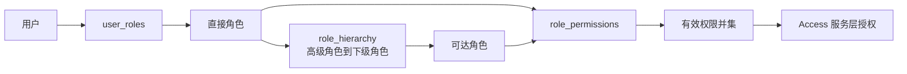

# 系统设计

## 分层

- `ui`：Swing 页面、菜单、对话框和显示格式；不直接访问数据库。
- `event`：`BackgroundAction` 把 `ActionListener` 的耗时工作放入 `SwingWorker`，结果在 EDT 回调。
- `service`：认证、用户、角色、权限、工单、统计、审计接口。
- `infrastructure`：SQLite 事务、会话注册表、密码散列和 `Access` 统一授权。
- `model`：不可变记录对象。

## RBAC1 数据流

`Access.effectivePermissions` 通过 SQLite `WITH RECURSIVE` 计算可达角色和去重后的权限。`Roles.effectivePermissions` 另外返回每项权限的直接/继承来源，供角色页面显示。

## 迁移和事务

`Database.initialize()` 读取 `schema_version`。新库建立基础模式和数据后执行 `migration_v2.sql`；版本 1 数据库只执行该迁移；版本 2 重启不重复执行。迁移创建带外键、复合主键、自继承检查和索引的 `role_hierarchy`。

所有层次写操作复用 `Access.write`：同一 `BEGIN IMMEDIATE` 事务内完成当前授权检查、角色/环校验、关系写入、最后管理员检查和成功审计。任一步失败都会回滚；拒绝审计在回滚后独立记录。

## UI 设计

角色页显示有效权限总数、直属下级，以及按 MENU/PAGE/ACTION 分组的权限来源；“配置继承”弹窗清楚说明当前角色为高级角色。工单与审计页面仅在显示时把 ISO 时间转换为 `yyyy-MM-dd HH:mm:ss`，数据库原始时间不变。