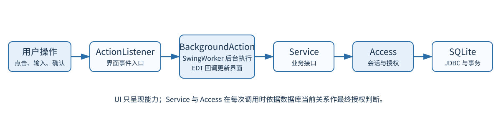
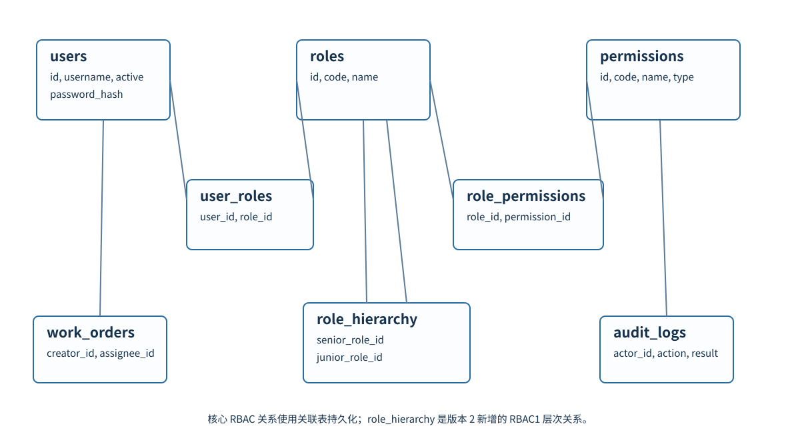
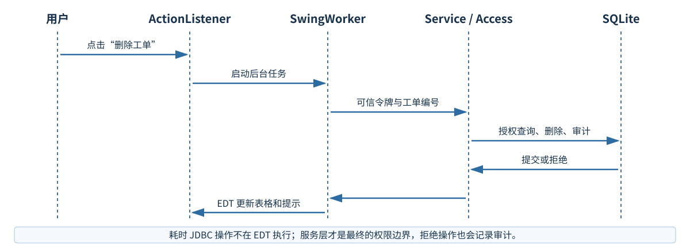

# 系统设计补充

## 分层与权限边界

`ui` 仅负责 Swing 页面、导航和控件状态；`event` 的 `BackgroundAction` 将耗时任务交给 `SwingWorker`；`service` 定义认证、角色、工单、统计和审计接口；`infrastructure` 中的 `Access` 从可信会话和数据库当前状态完成最终授权；SQLite JDBC 负责持久化与事务。UI 不直接访问数据库。

## RBAC1 数据模型

`role_hierarchy(senior_role_id, junior_role_id)` 表达“高级角色继承低级角色”。表以两列为联合主键、引用 `roles(id)` 并使用 `ON DELETE CASCADE`，另有 `CHECK (senior_role_id <> junior_role_id)`。服务层以递归 CTE 检查可达性，拒绝形成环。

## 迁移和事务

`Database.initialize()` 在版本 1 数据库执行 `migration_v2.sql`，在版本 2 重启时保持幂等。迁移只增加结构和版本记录，不重置业务数据或已有授权。层次、用户角色与角色权限写操作均通过 `Access.write`：同一 `BEGIN IMMEDIATE` 事务中依次完成当前授权、校验、写入、最后管理员检查和 SUCCESS 审计；失败回滚，DENIED 审计另行保存。

## 事件流程

退出登录后旧异步回调被丢弃，数据库操作和密码计算不阻塞 EDT。角色页面通过 `Services.Roles` 查询直接/继承来源，不在 UI 中硬编码数据库授权关系。